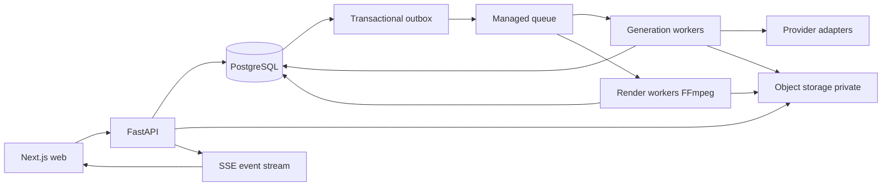

# AI Animation Studio V1.1 Balanced Mode

Tài liệu triển khai kỹ thuật • Phiên bản 1.1 • Ngày 14 tháng 10 năm 2026

## 1. Quyết định sản phẩm và phạm vi

Xây dựng ứng dụng web sản xuất video hoạt hình hoàn toàn trên cloud. Người dùng tạo dự án, nhập kịch bản, duyệt nhân vật và storyboard, xem dự toán rồi khởi chạy từng cảnh hoặc cả video. Balanced Mode ưu tiên tái sử dụng tài sản và chuyển động xác định; chỉ dùng video AI ở những cảnh cần chuyển động phức tạp. Mỗi lời gọi có phí phải được cấp ngân sách trước khi gửi.

Tài liệu này là baseline để đội sản phẩm, backend, frontend, QA và vận hành triển khai. Những giá trị mặc định dưới đây là quyết định thiết kế đề xuất, cần được hiệu chỉnh bằng pilot. Không coi mức chất lượng, tỷ lệ thành công hoặc giá minh họa là cam kết từ nhà cung cấp.

V1.1 bao gồm workspace đa người dùng, dự án, character bible, phân cảnh, reference ảnh, router, dự toán, ngân sách, generation job, review, ghép video, phụ đề, TTS và xuất MP4. Người dùng được thay cảnh, âm thanh hoặc phụ đề mà không tạo lại toàn bộ video. Chưa bao gồm huấn luyện model riêng, cộng tác chỉnh timeline thời gian thực, marketplace, thanh toán bán credits hay lip sync nâng cao. Đồng bộ miệng có thể dùng adapter riêng khi đủ năng lực và giá được xác nhận.

### 1.1 Mặc định vận hành

| Thuộc tính | Baseline V1.1 |
|---|---|
| Chế độ | Balanced, có ghi đè model sau khi dự toán lại |
| Đầu ra | MP4 H.264, 1080p, 24 hoặc 30 fps cố định theo dự án |
| Tỷ lệ | 16:9, 9:16; 1:1 nếu renderer hỗ trợ |
| Độ dài pilot | 30–120 giây; giới hạn sản phẩm 180 giây |
| Cảnh AI | Theo khoảng duration hợp lệ của model; chia cảnh dài trước khi báo giá |
| Đồng thời | 2 tác vụ video AI mỗi workspace; giới hạn provider độc lập |
| Dự toán | Hết hạn sau 15 phút hoặc ngay khi input/giá/policy thay đổi |
| Retry sáng tạo | 1 lần tạo lại tự động mỗi cảnh, tối đa 2 video candidates |
| Retry truyền tải | Tối đa 3 lần chỉ khi biết chắc chưa tạo job có phí hoặc dùng idempotency của provider |
| Tiền tệ nội bộ | USD, số nguyên micro-USD; hiển thị tiền tệ khác chỉ để tham khảo |
| Dự phòng | Cấu hình theo operation; không mặc định cộng % thay cho giá trần thực |
| Bảo lưu dữ liệu | Tài sản gốc theo chính sách workspace; log kỹ thuật 30 ngày, ledger 12 tháng mặc định |

### 1.2 Tiêu chí nghiệm thu sản phẩm

Mọi cảnh có kế hoạch model, lý do chọn, chi phí cơ sở và mức trần. Không khởi chạy từ quote hết hạn. Hai lệnh chạy đồng thời không cấp vượt hạn mức. Người dùng luôn thấy đã chi, đang giữ, còn khả dụng và khoản chưa đối soát. Job bị timeout không tự gửi một job mới khi kết quả gửi cũ chưa rõ. Cảnh đã duyệt được tái sử dụng qua những lần render khác nếu đầu vào không thay đổi. Các target chất lượng chỉ thành tiêu chí chính thức sau pilot.

## 2. Kiến trúc cloud



Đề xuất triển khai ban đầu: container cloud cho FastAPI và workers, PostgreSQL managed có PITR, queue managed, object storage tương thích S3, CDN cho file xuất, secret manager, registry và CI/CD. Một cloud chính giúp giảm độ phức tạp; chọn region sau khi kiểm tra độ trễ provider và yêu cầu dữ liệu. Không cần GPU tự quản ở V1.1. Nhà cung cấp AI xử lý inference; worker render dùng CPU cloud. Redis chỉ dùng cache, rate limit và semaphore tối ưu; không là nguồn sự thật của tiền.

FastAPI chịu authentication, authorization, nghiệp vụ, quote và ledger. Worker không thực hiện business logic riêng khác API: cùng dùng package domain. Một process API mỗi container và scale replicas; generation worker và render worker scale độc lập. Không chạy job dài trong FastAPI BackgroundTasks. Hàng đợi có thể giao thông điệp nhiều lần; hệ thống xử lý idempotent.

Module backend: identity, projects, scene_planner, asset_catalog, model_catalog, router, quoting, budget, orchestration, provider_adapters, review, rendering, audit. Mỗi adapter có validate_input, price_bound, submit, lookup, poll, cancel, verify_webhook, normalize_result và normalize_usage. Adapter phải khai báo có hỗ trợ idempotency và tra cứu theo client reference hay không.

### 2.1 Pipeline và các cổng duyệt

1. Nhập brief và kịch bản; planner tạo scene draft có duration, nhân vật, lời thoại và chuyển động.
2. Tạo character bible: ảnh reference đã duyệt, palette, trang phục, tỷ lệ, voice và điều cấm thay đổi.
3. Tạo keyframe/storyboard ở chi phí thấp. Preflight kiểm tra reference, prompt, aspect, duration, an toàn và năng lực provider.
4. Người dùng duyệt storyboard; chốt scene revision và các asset hash. Chỉ sau bước này tạo quote video chính thức.
5. Router chọn route mỗi cảnh; quote bao gồm ảnh/TTS còn thiếu, video, creative retry được phép, render và tài nguyên liên quan.
6. Người dùng chấp nhận quote và trần run; giao dịch giữ ngân sách, tạo run và outbox.
7. Worker tạo tác vụ theo DAG, đối soát chi phí, chạy QC. Những cảnh lỗi sáng tạo được retry theo policy; cảnh cần duyệt chuyển sang needs_review.
8. Người dùng chọn candidate; renderer ghép asset đã duyệt, TTS, nhạc và phụ đề; tạo export manifest.

DAG: reference → keyframe → motion/video → scene QC → approval → assembly. TTS có thể song song sau khi khóa script; render cần đủ asset đã duyệt. Sửa script invalidates TTS; sửa subtitle text không invalidates video; sửa reference/prompt/model/duration invalidates generation tương ứng. Mọi run lưu snapshot bất biến để chỉnh dự án không làm đổi job đang chạy.

## 3. Smart Model Router cho từng cảnh

### 3.1 Input và output

Scene features gồm shot_type, motion_level 0–3, camera_motion 0–3, character_count, identity_priority 0–3, interaction_level 0–3, dialogue, lip_sync_required, duration_ms, style, aspect_ratio, resolution, reference_assets, text_in_frame và deadline. Planner có thể gợi ý features; người dùng sửa được. Feature không chắc chắn phải đánh dấu confidence và cần duyệt nếu ảnh hưởng mạnh đến giá.

Output là route_plan bất biến: scene_revision, primary_route, model_version, render recipe, normalized provider parameters, estimated_base, authorization_ceiling, permitted fallback, retry policy, price_version, router_version, rationale và limitations. Fallback chỉ là lựa chọn đã được quote; không tự nâng lên model đắt hơn vì provider lỗi.

### 3.2 Bộ lọc và chấm điểm

Trước hết lọc cứng: hỗ trợ style/reference/aspect/duration/resolution, quyền dùng dữ liệu, địa lý, provider đang hoạt động, giới hạn size, khả năng bound chi phí và latency phù hợp. Không có candidate hợp lệ thì trả needs_changes; không tự chọn model rẻ nhưng thiếu tính năng bắt buộc. Reference consistency và lip sync là capability cần đánh giá riêng, không suy ra từ tên model.

Sau lọc, chấm điểm đề xuất:

`score = 0.45 * quality_fit + 0.25 * identity_fit + 0.20 * cost_efficiency + 0.10 * latency_fit`

Mỗi thành phần chuẩn hóa 0–1 trên benchmark nội bộ cho cùng loại cảnh. Cost_efficiency dùng expected total cost đạt QC, bao gồm xác suất retry ước lượng, không chỉ giá một lần gọi. Candidate thiếu benchmark nhận confidence thấp và không vào auto-route production trước khi được kiểm định. Tỷ lệ thành công thống kê cần số mẫu và thời gian quan sát; không để vài lỗi ngắn hạn làm router đổi model liên tục. Tie-break: chi phí trần thấp, latency thấp, model_id để kết quả xác định.

| Nhóm cảnh | Route mặc định | Điều kiện nâng route |
|---|---|---|
| Tiêu đề, chữ, biểu đồ, ảnh tĩnh | Renderer xác định | Chỉ thêm video AI khi yêu cầu chuyển động vật thể |
| Establishing shot, pan/zoom nhẹ | Ảnh duyệt + camera 2.5D | Chuyển động môi trường quan trọng |
| Nhân vật cử động nhẹ | Image-to-video tier tiết kiệm đã benchmark | Identity hoặc motion không đạt QC |
| Tương tác nhiều nhân vật, hành động | Image-to-video tier tiêu chuẩn | Hero shot hoặc requirement vượt capability |
| Hero shot phức tạp | Tier cao có chủ ý | Người dùng duyệt giá và reference |
| Thoại không cần khẩu hình | Ảnh/motion nhẹ + TTS + subtitle | Chỉ dùng lip sync khi người dùng yêu cầu |

Tier là nhãn nội bộ, không là tên sản phẩm provider. Model catalog cập nhật giá, phiên bản và capability từ nguồn nhà cung cấp; người vận hành xác nhận trước khi active. Không hardcode tên model cụ thể vào router. Chính sách Balanced đề xuất ít nhất 40% duration dùng renderer/2.5D nếu kịch bản cho phép, tối đa 20% duration hero route; đây là gợi ý tối ưu, không ép nếu phá ý đồ. Vượt tỷ lệ hiển thị lý do và dự toán mới.

### 3.3 Pseudocode

```python
def route(scene, catalog, policy, benchmarks):
    candidates = hard_filter(scene, catalog, policy)
    candidates = [c for c in candidates if c.price_bound_is_known]
    if not candidates:
        return NeedsChanges("NO_ELIGIBLE_ROUTE")
    plans = [build_plan(scene, c, policy, benchmarks) for c in candidates]
    winner = sorted(plans, key=lambda p: (-p.score, p.ceiling, p.latency, p.id))[0]
    return freeze_plan(winner, scene.revision, catalog.version, policy.version)
```

Ảnh đầu vào và camera recipe cũng là candidate route; không mặc định mọi cảnh đều phải gọi video model. Route explain hiển thị hai phương án thay thế cùng chất lượng dự kiến, mức tin cậy và chênh lệch trần.

## 4. Dự toán chi phí trước khi chạy

### 4.1 Đơn vị và công thức

Lưu tiền dưới dạng bigint micro-USD, 1 USD = 1.000.000 đơn vị. Không dùng float. Duration tính ms và làm tròn theo billing block của provider. Giá phiên bản hóa có currency, unit, unit_size, minimum_charge, rounding, failure_billing, fixed_fee, resolution multiplier, valid_from, valid_until, source_url và verified_at. Nếu trả theo currency khác, snapshot tỷ giá và trần chuyển đổi; chặn route nếu không thể xác định upper bound chấp nhận được.

`base = Σ maximum_charge(first_attempt_operation_i)`

`expected = Σ cost_i * expected_attempts_i + estimated_render_storage_egress`

`ceiling = Σ bounded_charge(all_authorized_attempts_i) + bounded_auxiliary_cost`

Expected chỉ để tham khảo. Ceiling dùng để cấp ngân sách; không lấy expected làm hard limit. Bao gồm prompt/LLM, ảnh, TTS, video, lip sync nếu có, render, export và storage/egress trong phạm vi hạn mức đã định. Cloud cố định, thuế và phí chưa bound được hiển thị riêng. Hạn mức ứng dụng bảo vệ các tác vụ đã đi qua ứng dụng; không thể bảo đảm hóa đơn cloud tổng nếu còn tải xuống ngoài phạm vi hoặc provider tính phí khác hợp đồng. V1.1 giới hạn dung lượng, thời gian giữ, số export và download; có billing alerts ở cloud.

### 4.2 Ví dụ số học minh họa

Video 60 giây: 20 giây 2.5D, 30 giây video tier tiêu chuẩn, 10 giây hero. Giả sử giá minh họa tiêu chuẩn 0,08 USD/s, hero 0,20 USD/s, ảnh và TTS 0,50 USD, render 0,20 USD. Base = 2,40 + 2,00 + 0,50 + 0,20 = 5,10 USD. Cho phép tạo lại một cảnh tiêu chuẩn 5 giây và một hero 5 giây: thêm 0,40 + 1,00 = 1,40 USD; trần = 6,50 USD nếu toàn bộ thành phần đã được bound. Đây không là bảng giá thực tế. Nếu cho phép retry mọi cảnh video một lần thì phần dự phòng phải là 4,40 USD và trần 9,50 USD.

### 4.3 Quy tắc quote

Quote snapshot tất cả revision, asset hash, route plan, parameters, bảng giá và policy. Hash SHA-256 canonical JSON; không đưa timestamp ngẫu nhiên vào input hash. Quote không thể sửa, chỉ tạo bản mới. Khi submit, backend kiểm tra ownership, quyền, expiry, input hash, giá còn valid và version policy. Thay giá ảnh hưởng upper bound thì bắt buộc quote mới; không tự dùng giá cũ đã hết hiệu lực. Quote hiển thị base, expected, ceiling, phần dự phòng, operation chưa bao gồm và các đường giảm chi phí.

Chấp nhận quote không cho phép chi quá ceiling. Nếu ngân sách nhỏ hơn ceiling, hệ thống gợi ý giảm motion, chia cảnh, giảm resolution hỗ trợ, giới hạn retry hoặc chọn cảnh để chạy trước. Không âm thầm giảm chất lượng. Quote preview không gọi AI có phí; nếu cần tạo storyboard phải có quote và cấp ngân sách riêng cho phase đó.

## 5. Ngân sách và khóa chi phí đồng thời

### 5.1 Mô hình kế toán

Ba scope bắt buộc: workspace theo kỳ UTC, project tổng vòng đời, run theo quote. Tùy chọn thêm scene cap. Một operation phải phù hợp tất cả scope. `available = limit - spent - held`. Spent là khoản đã ghi nhận, held là tiền còn giữ cho tác vụ chưa quyết toán; unknown cũng nằm trong held. Ledger append-only, corrections là entry mới. Giá trị tổng ở budget_accounts là cache giao dịch được kiểm tra đối chiếu ledger.

Khi chấp nhận quote, giữ toàn bộ ceiling ở cả workspace-period và project; tạo run account với limit=ceiling. Run hold là nguồn cho các operation, tránh giữ hai lần ở cùng scope. Khi dispatch, phân bổ operation allocation trong run; đây không cộng thêm project/workspace held. Chỉ bổ sung hold khi người dùng chấp nhận quote amendment. Không dùng khóa Redis để bảo vệ chi phí.

### 5.2 Giao dịch accept run

Trong READ COMMITTED: khóa project revision, quote, các budget account theo thứ tự UUID tăng dần bằng SELECT FOR UPDATE; mọi đường viết tuân cùng thứ tự. Kiểm tra quote và idempotency. Nếu mọi account đủ available, cộng held=ceiling, tạo run, liên kết reservation với accounts, ghi ledger HOLD và outbox rồi commit. Nếu không đủ, rollback toàn bộ. Không gọi provider trong transaction. Row lock giữ đến hết giao dịch; timeout khóa trả lỗi có thể thử lại với cùng idempotency key. PostgreSQL mô tả cơ chế này trong [Explicit Locking](https://www.postgresql.org/docs/17/explicit-locking.html).

Idempotency key scope theo workspace và endpoint, request hash bắt buộc khớp. Hai request cùng key trả cùng run; cùng key khác payload trả 409. Unique constraint là hàng rào cuối khi hai request đua nhau. API chỉ trả 202 sau commit; outbox relay gửi queue rồi ghi delivered. Crash sau gửi có thể giao lại; worker claim operation atomically.

### 5.3 Giao dịch cấp operation và quyết toán

Trước submit, khóa reservation/run và operation. Kiểm tra state, run stop flag, attempt limit, allocation còn đủ, provider semaphore. Đánh dấu dispatching, gắn provider request key duy nhất, dành operation ceiling trong phần held của run rồi commit. Việc phân bổ và giải phóng chỉ chuyển unallocated ↔ allocated, không thay tổng held scope.

Khi có usage xác định C với hold allocation H: khóa tất cả account liên quan, reservation và operation theo thứ tự thống nhất; ghi settlement unique cho operation; giảm held H, tăng spent C, giảm reservation.remaining H. Nếu C < H, phần chênh lệch khả dụng được trả lại. Nếu muốn dùng khoản đó retry thì cần cấp allocation mới từ tiền còn được run giữ hoặc giữ bổ sung không vượt run ceiling và các account. Khi run kết thúc, release phần hold chưa dùng. Tác vụ chắc chắn không bị tính phí settle C=0. Tác vụ chưa rõ chi phí giữ allocation và status reconciliation_pending.

Nếu provider báo C > H, ghi đủ actual để ledger trung thực, tạo incident, chặn dispatch scope ảnh hưởng và cảnh báo; không cắt actual về H. Bảo đảm không vượt cap chỉ đúng khi provider upper bound chính xác. Production gate bắt buộc kiểm chứng rounding, phí failure và output billing; provider không bound được phí phải dùng scope hạn chế có phê duyệt vận hành hoặc tắt trong Balanced auto-route.

### 5.4 Trường hợp khó

| Tình huống | Hành vi bắt buộc |
|---|---|
| Hai run dùng ngân sách cuối | Account lock cho một run giữ trước; run sau bị 409 BUDGET_EXCEEDED |
| Timeout sau submit | Giữ tiền; lookup client reference; không gửi key mới |
| Provider không lookup/idempotency | Sau trạng thái gửi mơ hồ, needs_reconciliation và can thiệp; không auto-resubmit |
| Cancel | Dừng tác vụ chưa gửi; gọi cancel tác vụ đã gửi nếu có; giữ tiền đến xác nhận usage |
| Worker chết | Lease hết hạn cho phép tiếp quản poll/reconcile; không tự đồng nghĩa được submit mới |
| Callback trùng/đảo thứ tự | Unique event và state transition đơn điệu; settle một lần |
| Sang kỳ ngân sách mới | Reservation thuộc kỳ lúc accept; không chuyển tiền sang kỳ mới; cảnh dispatch sau ranh giới cần kiểm tra hạn mức kỳ dispatch theo policy |
| Hạ budget dưới spent + held | Trả 409; cho phép đặt stop flag và giảm limit sau khi giải phóng đủ |
| Provider credit/refund | Ledger credit có external reference duy nhất; không sửa settlement cũ |

Chính sách kỳ V1.1: không dispatch mới từ reservation kỳ cũ sau ranh giới UTC. Paused_budget_period; re-quote/re-reserve vào kỳ mới trước khi chạy phần chưa gửi, release hold cũ tương ứng atomically. Operation đã gửi tiếp tục settle vào account kỳ cũ. UI hiển thị timezone người dùng nhưng backend kỳ dùng UTC.

## 6. Hạn chế retry và giảm tạo lại video

Retry kỹ thuật và retry sáng tạo tách riêng counters. Poll, webhook delivery và tải file lại không tạo candidate mới. Technical retry chỉ cho 429/5xx trước khi provider nhận, hoặc submit lại cùng key được provider đảm bảo; exponential backoff có jitter 2/4/8 giây, tôn trọng Retry-After và max elapsed. Lỗi validation, auth, policy và insufficient budget không retry.

Creative retry chỉ sau QC kết luận có thể sửa: tối đa một retry tự động mỗi cảnh, tối đa hai candidates, trong route/price/attempt cap đã duyệt. Hết cap chuyển needs_review. User retry thủ công tạo quote amendment, không reset history hoặc vượt project/workspace cap. Fallback sang model khác cũng là một creative attempt có phí. Không retry cùng prompt mù quáng: ghi reason code, thay prompt hoặc reference có kiểm soát, giữ seed nếu provider hỗ trợ.

QC cứng: file hợp lệ, duration đúng tolerance theo adapter, resolution/aspect, không thiếu audio được yêu cầu, không black frames kéo dài. QC mềm: identity, flicker, anatomy, motion, adherence; ngưỡng hiệu chỉnh bằng bộ cảnh benchmark. Model đánh giá chất lượng không tự tạo vòng retry vô hạn và phải được quote nếu có phí. Khi QC thiếu tin cậy, người dùng quyết định. Safety rejection không sửa prompt để né bộ lọc.

Giảm lần tạo lại bằng: duyệt storyboard trước video; character bible cố định; dùng ảnh reference có version; một cảnh có một hành động chính; cảnh ngắn; prompt compiler theo adapter; chữ luôn dựng bằng renderer; cảnh thoại ưu tiên TTS và subtitles khi không cần lip sync; render preview resolution thấp; cache asset cùng workspace theo fingerprint; sửa timeline không sinh lại video. Không cache xuyên tenant; fingerprint gồm model version, seed, prompt, references, aspect, duration và generation params. Người dùng bật regenerate thì tạo request mới có quote; không phá cache gốc.

## 7. Schema PostgreSQL

Migration nền nằm trong file SQL đi kèm. Schema dùng UUID, timestamptz, bigint micro-USD và JSONB chỉ cho provider payload/features linh hoạt. Những trường quyết định tiền, ownership, state và uniqueness là cột quan hệ. Bản SQL là foundation cho triển khai, không thay thế dịch vụ giao dịch, authorization và các migration bổ sung của sản phẩm.

| Bảng | Vai trò và ràng buộc chính |
|---|---|
| workspaces, memberships | Tenant và vai trò owner/editor/reviewer/viewer |
| projects, scenes, scene_revisions | Revision bất biến, vị trí cảnh unique trong project |
| assets | Object key private, hash, lineage và metadata |
| model_versions, price_versions | Năng lực, giá phiên bản hóa, trạng thái active |
| quotes, quote_lines | Input snapshot, ceiling, route và operation breakdown |
| budget_accounts | Scope/kỳ, limit/spent/held không âm |
| runs, reservations, reservation_accounts | Run snapshot và hold trên mọi scope |
| operations | Đơn vị dispatch/settle, attempt, request key, lease |
| operation_settlements, budget_ledger | Usage duy nhất và ledger append-only |
| provider_events, outbox | Dedup callback, reliable dispatch |
| idempotency_keys, audit_events | Retry API an toàn và truy vết |

Tất cả FK tenant quan trọng dùng composite (workspace_id,id); truy vấn luôn lọc workspace. Dùng RLS defense-in-depth, SET LOCAL tenant trong transaction, service role không mặc định bypass. Worker nhận workspace từ DB, không tin payload queue. Migration production tạo policy cho từng bảng tenant và kiểm thử isolation trước mở public. Ledger chỉ INSERT cho service role kế toán; UPDATE/DELETE bị revoke. Giá và revision sau publish không được sửa, chỉ thêm version mới. Index bổ sung theo query plan sau pilot, không index JSONB toàn bộ tùy tiện.

### 7.1 Invariants dịch vụ phải bảo vệ

Mỗi run có một reservation; mỗi reservation account thuộc cùng workspace. Reservation.remaining bằng hold chưa quyết toán của run. Tổng allocation của operations active không vượt remaining. Ledger HOLD/SETTLE/RELEASE cập nhật totals cùng transaction. Operation attempt_no tăng đơn điệu theo scene revision và operation kind; không tạo lại slot khi worker crash. Settlement external reference duy nhất; operation terminal không trở lại dispatching. Account bị provider overrun có thể spent+held>limit để phản ánh thực tế nhưng block dispatch; không thêm CHECK làm mất actual cost.

## 8. API FastAPI

Prefix `/api/v1`; OpenAPI là contract cho client TypeScript sinh tự động. OAuth/OIDC JWT hoặc session BFF, kiểm issuer/audience/expiry và workspace membership tại backend. DTO Pydantic strict, giới hạn length/size, enum rõ ràng. Decimal tiền trả string USD và integer micro_usd; không nhận số float. List dùng cursor và limit tối đa 100. Mutation quan trọng nhận Idempotency-Key; chỉnh project/scene dùng If-Match revision, lỗi 412 khi stale.

| Method và route | Nội dung | Quyền |
|---|---|---|
| POST /workspaces/{w}/projects | Tạo dự án | editor |
| GET /projects/{id} | Dự án và latest revision | viewer |
| PATCH /projects/{id} | Metadata với If-Match | editor |
| POST /projects/{id}/scene-revisions | Chốt batch cảnh, không sửa lịch sử | editor |
| POST /assets/upload-intents | Presigned upload hạn size/type | editor |
| POST /assets/{id}/complete | Verify object và quarantine scan | editor |
| POST /projects/{id}/quotes | Quote phase storyboard/video/export | editor |
| GET /quotes/{id} | Breakdown và route explanations | viewer |
| POST /quotes/{id}/runs | Accept quote và giữ ngân sách | editor |
| GET /runs/{id} | Tiến độ, held/spent, reconciliation | viewer |
| POST /runs/{id}/cancel | Dừng có tính phí đã phát sinh | editor |
| POST /scenes/{id}/retry-quotes | Quote amendment retry thủ công | editor |
| POST /operations/{id}/approve | Chọn candidate đã QC | reviewer |
| POST /projects/{id}/export-quotes | Quote export từ asset đã duyệt | editor |
| GET /projects/{id}/budget | Ledger tổng và availability | viewer |
| PATCH /budget-accounts/{id} | Hạn mức, stop flag | owner |
| GET /runs/{id}/events | SSE có Last-Event-ID | viewer |
| POST /providers/{provider}/webhook | Raw-body signature, dedup, queued xử lý | provider |
| GET /exports/{id}/download | Signed URL ngắn hạn sau auth | viewer |

### 8.1 Request và response mẫu

```json
POST /projects/PROJECT_ID/quotes
{
  "phase": "video",
  "project_revision": 7,
  "scene_ids": ["SCENE_A", "SCENE_B"],
  "mode": "balanced",
  "policy_version": "balanced-1.1",
  "retry_budget_micro_usd": 1400000
}
```

```json
{
  "quote_id": "QUOTE_ID",
  "currency": "USD",
  "base_micro_usd": 5100000,
  "expected_micro_usd": 5600000,
  "ceiling_micro_usd": 6500000,
  "expires_at": "2026-10-14T10:15:00Z",
  "input_hash": "sha256:...",
  "excluded_costs": ["monthly fixed infrastructure"],
  "lines": [{"scene_id": "SCENE_A", "route": "image_to_video", "model_version_id": "MODEL_ID", "max_attempts": 2, "ceiling_micro_usd": 800000}]
}
```

```json
POST /quotes/QUOTE_ID/runs
{"accepted_ceiling_micro_usd":6500000,"input_hash":"sha256:..."}

202
{"run_id":"RUN_ID","status":"queued","held_micro_usd":6500000}
```

Các ID trong ví dụ là placeholder; implementation dùng UUID hợp lệ. Client không quyết định charge hoặc model giá; server dùng quote snapshot. 409 BUDGET_EXCEEDED trả account scope và available; 409 QUOTE_EXPIRED/PRICE_CHANGED yêu cầu quote mới; 409 IDEMPOTENCY_CONFLICT; 422 INVALID_SCENE; 429 RATE_LIMITED; 503 PROVIDER_UNAVAILABLE. Error envelope `{code,message,details,request_id}` không lộ raw provider secrets.

### 8.2 State machine

Run: queued → running → needs_review → rendering → completed. Có thể chuyển paused_budget, paused_provider, reconciliation_pending, failed, cancelling, cancelled. Run chỉ completed khi export thành công và cost resolved; nếu deliverable đã có nhưng usage chưa rõ, hiển thị delivered_pending_reconciliation.

Operation: pending → allocated → dispatching → submitted → polling → succeeded hoặc failed; dispatching → submission_unknown nếu gửi mơ hồ; succeeded → QC review theo trường qc_status riêng. Cancellation là requested flag, trạng thái cancelled chỉ khi provider xác nhận hoặc tác vụ chắc chắn chưa gửi. State transitions dùng UPDATE WHERE state IN expected, version optimistic; callback quá cũ chỉ lưu audit.

## 9. Giao diện Next.js

Dùng App Router, server components cho tải dữ liệu ban đầu, client components cho storyboard, progress và timeline. BFF/session adapter chỉ truyền request có xác thực; provider keys luôn server-side. Authorization được thực hiện gần dữ liệu theo [hướng dẫn Next.js](https://nextjs.org/docs/app/guides/authentication), backend vẫn kiểm mọi mutation. Data budget và user projects không cache chung giữa tenants; sau mutation invalidation đúng workspace.

### 9.1 Các màn hình

1. Dashboard: dự án gần đây, workspace budget, đang giữ, chưa đối soát và job cần duyệt.
2. Project setup: title, style, ratio, fps, duration target, budget, ngôn ngữ và voice.
3. Character bible: reference, costume, voice, approval, version; cảnh báo các cảnh sẽ invalidated khi đổi.
4. Storyboard: thẻ cảnh với script, keyframe, duration, motion, route và chi phí. Đánh dấu cảnh giữ lại, chia/gộp, preview chuyển động nhẹ.
5. Estimate review: bảng từng cảnh, base/expected/ceiling, retry allowance, included/excluded, quote expiry và ngân sách khả dụng trên mọi scope. CTA “Chạy với trần …” chỉ enabled sau khi storyboard valid.
6. Production: trạng thái từng operation, candidates, QC reason, spent/held/live availability. “Dừng tác vụ mới” tách với hủy provider và thông báo chi phí còn pending.
7. Review và timeline: chọn candidate, trim trong duration đã có, transition, volume, subtitles và export. Thay timeline chỉ render lại.
8. Budget và audit: hạn mức owner, ledger, adjustment history, provider reconciliation. Viewer chỉ đọc.

Wireframe Estimate: header tổng thời lượng và mode; trái danh sách scene route; phải budget base/expected/ceiling và scope available; cuối trang nút re-estimate/chạy. Trạng thái vượt budget hiển thị phương án giảm giá có số chênh lệch, không chỉ báo lỗi đỏ. UI label route dùng “Ảnh có chuyển động”, “Video AI tiêu chuẩn”, “Cảnh chất lượng cao”; phần nâng cao mới hiện model version.

SSE chỉ báo trạng thái/metrics không chứa prompt bí mật hay signed URLs. Event ID persisted, reconnect Last-Event-ID; nếu event history hết hạn client fetch run snapshot. Có polling fallback 5–10 giây với backoff, dừng khi tab ẩn nếu không cần. Tiến độ hiển thị số cảnh hoàn tất và trạng thái, tránh phần trăm/ETA giả. Accessibility: keyboard navigation, focus rõ, màu không là tín hiệu duy nhất, subtitle preview và responsive layout.

## 10. Bảo mật và quản lý tài sản

Bucket private, signed URL thời hạn ngắn, object keys không chứa PII, encryption at rest và TLS. Upload giới hạn MIME/bytes, xác minh magic bytes, quét file, decode media sandbox, chặn SVG/script nếu chưa sanitize. URL import đi qua fetch service chống SSRF: chặn private/link-local/metadata IP, kiểm redirect và DNS lại, allowlist protocol, hạn bytes/time. Không chạy shell command ghép prompt người dùng; FFmpeg args truyền mảng.

Secrets trong secret manager, rotate, không trả provider key ra browser. Webhook xác thực raw-body signature/timestamp/replay theo provider; callback URL không tin asset URL chưa kiểm origin. Audit owner changes, quote accept, retry, cancel, approvals và budget edits. Prompt/asset có thể là dữ liệu không đáng tin; planner không được cấp quyền thanh toán hoặc sửa budget. Xác nhận quyền dùng reference và voice tại intake; ghi provenance, retention và thao tác xóa. Xóa dự án vô hiệu hóa URL và xóa object theo job; ledger giữ dữ liệu tối thiểu phục vụ đối soát.

## 11. Triển khai và vận hành

### 11.1 Cấu trúc repository

```text
apps/web/                Next.js
services/api/            FastAPI routes và auth
services/workers/        dispatch, polling, QC, render
packages/domain/         router, quote, budget, state machines
packages/adapters/       provider adapters và fake provider
db/migrations/           Alembic, schema và RLS
infra/                   IaC, cloud resources, secrets references
tests/                   contract, integration, concurrency, e2e
docs/                    ADR, runbooks, pricing verification
```

Pin exact dependency versions trong lockfiles và container image digests sau khi kiểm security; không dùng tag latest cho production. Dev dùng fake provider, staging dùng provider thật với budget nhỏ; production secrets tách biệt. Configuration gồm DATABASE_URL, QUEUE_URL, OBJECT_BUCKET, OIDC issuer/audience, signing secret reference, provider allowlist, global kill switch, max concurrent jobs và pricing freshness. Không commit giá bí mật hoặc keys.

### 11.2 Quy trình release

CI: lint/typecheck → unit → migrations trong PostgreSQL tạm → integration/concurrency → OpenAPI client compatibility → web build/e2e → container scan → staging → smoke → production canary. Migration expand/contract, backfill batch, không drop cột còn được release cũ dùng. Rollback application theo image; không tự rollback migration dữ liệu. Provider adapter enable bằng feature flag sau contract test và kiểm giá.

Readiness API kiểm DB/queue dependency cần thiết, liveness chỉ process. Graceful worker shutdown ngừng claim mới, giữ trạng thái submit để người tiếp quản tra cứu. Outbox relay có retry và dead-letter với re-drive theo ID cũ. Render worker chạy filesystem tạm riêng, giới hạn CPU/RAM/time, xóa scratch sau job. Export manifest chứa asset hash, timeline version, codec/fps, renderer version và output checksum.

### 11.3 SLO và quan sát

Target pilot: API p95 đọc dưới 500 ms, quote không gọi provider dưới 2 giây với 30 cảnh; acceptance dưới 1 giây khi DB không contention. Availability mục tiêu 99,5% tháng cho control plane; provider latency là chỉ số riêng. Worker recovery trong 5 phút; không cam kết thời gian video trước benchmark. Backup PITR, RPO mục tiêu ≤15 phút, RTO ≤4 giờ và drill phục hồi trước launch.

Metrics: reserved/spent/available, reconciliation age, overrun count, duplicate suppression, attempts/scene, QC accept rate theo model và scene type, outbox lag, queue age, provider error/rate limits, render failure, cost per accepted second. Trace nối request_id/run_id/operation_id/provider_request_id. Không đưa PII hoặc prompt vào metric labels. Alerts: overrun ngay lập tức; unknown submission >15 phút; outbox lag >60 giây; reconcile backlog >1 giờ; account totals lệch ledger bất kỳ; queue age >10 phút; chi tiêu tăng đột biến.

Runbooks bắt buộc: provider outage (pause dispatch, không fallback ngoài quote), stuck submit (lookup rồi reconcile), budget overrun (kill switch scope, giữ actual), ledger mismatch (pause mutations, đối chiếu), queue duplicate, storage failure, DB restore. Job đối soát chạy thường xuyên nhưng không giải phóng unknown hold chỉ vì hết TTL. TTL chỉ dành reservation chưa dispatch và đã hủy được chắc chắn.

## 12. Kế hoạch kiểm thử

| Nhóm | Ca quan trọng | Điều kiện pass |
|---|---|---|
| Router | Thiếu reference, duration không hỗ trợ, lip sync bắt buộc, model inactive | Không route sai capability; kết quả deterministic |
| Pricing | Billing block, minimum fee, rounding, multi-attempt, stale price | Integer arithmetic, ceiling đủ mọi authorized calls |
| Budget concurrency | 50 requests trên ngân sách chỉ đủ một run | Chỉ một reservation được cấp; không âm available |
| Nested scope | Project còn tiền nhưng workspace hết; thứ tự locks khác request | Rollback toàn bộ, không partial hold/deadlock kéo dài |
| API idempotency | Cùng key đồng thời, khác payload, crash sau commit | Một run/outbox logical; khác payload 409 |
| Submit crash | Crash trước gửi, sau gửi trước save ID, timeout mơ hồ | Không duplicate paid job; giữ allocation |
| Callback | Trùng 100 lần, success trước submitted, failure sau success | Một settlement, không state regression |
| Retry | 429, validation, creative reject, hết cap, user retry | Counters đúng; quote mới khi cần; không vòng lặp |
| Settlement | C=0, C<H, C=H, C>H, refund, duplicate receipt | Ledger đúng; actual không bị cắt; overrun block |
| Cancel | Trước dispatch, trong submit, provider cancel không hỗ trợ | Không release sớm; reconcile đúng |
| Period | Accept trước UTC midnight, dispatch sau midnight | Chặn dispatch cũ và chuyển hold atomically |
| Tenant | Đoán project ID, signed URL, SSE, worker payload giả | Không đọc/ghi chéo workspace |
| Media | File lỗi, audio lệch, subtitle dài, scene thiếu, fps mismatch | QC chặn output lỗi; export reproducible |
| E2E | Brief → storyboard → quote → run → review → export | UI money khớp ledger, video phát được |
| Recovery | Queue at-least-once, DB failover, outbox crash, restore | Không mất job hoặc settle kép |

Concurrency test phải dùng PostgreSQL thật với nhiều connections, không SQLite/in-memory. Fake provider mô phỏng idempotency có/không, ambiguous submit và delayed invoice. Property tests kiểm mọi chuỗi HOLD/SETTLE/RELEASE duy trì tổng và không cấp vượt cap khi upper bound đúng. Fault injection đặt crash tại từng ranh giới DB/network. Provider contract suite chạy staging với quota riêng, kiểm rounding và billing failed job.

Golden set pilot tối thiểu 60 cảnh phân nhóm: tĩnh, chuyển động nhẹ, identity, nhiều nhân vật, action, thoại. Reviewer chấm rubric 1–5, ghi tỷ lệ pass lần đầu và cost/accepted second; không dùng một điểm tổng che lỗi identity. Mục tiêu pilot đề xuất ≥80% cảnh được chấp nhận trong hai candidates; điều chỉnh route sau số liệu. Đây là target thử nghiệm, không là khả năng đã chứng minh.

## 13. Lộ trình xây dựng

Đề xuất 8 tuần với 2 backend, 1 frontend, 1 full-stack/infra, QA bán thời gian và product owner. Thời gian giả định provider credentials, hạn mức và yêu cầu quyền sử dụng dữ liệu được chuẩn bị. Mỗi giai đoạn kết thúc bằng demo có điều kiện pass; không mở paid production chỉ dựa vào tiến độ lịch.

| Giai đoạn | Công việc | Gate |
|---|---|---|
| Tuần 1 | ADR, catalog, pricing model, schema, auth, fake provider, IaC | Giá trần và tenant isolation được thiết kế rõ |
| Tuần 2 | Quote, budget accounts, reservations, ledger, concurrency | 50-way race và idempotency pass |
| Tuần 3 | Outbox, queue, adapter, ambiguous submit, reconciliation | Crash matrix không duplicate paid submit |
| Tuần 4 | Scene planner, bible, storyboard approval, router | Route explain và invalidation hoạt động |
| Tuần 5 | Next.js estimate/production/review, SSE | E2E với fake provider hoàn chỉnh |
| Tuần 6 | TTS, media QC, timeline, FFmpeg export, reuse | Xuất video pilot và sửa cảnh độc lập |
| Tuần 7 | Provider thật, benchmark, security, load, backup drill | Giá thực và retry cap được xác nhận |
| Tuần 8 | Pilot giới hạn, tuning, runbooks, canary | Không ledger mismatch/duplicate, owner sign-off |

Ưu tiên P0: budget atomicity, idempotency, unknown submit, immutable quote, tenant isolation. P1: router benchmark, QC, asset reuse, timeline, exports. P2: đa provider rộng, advanced lip sync, nâng cấp editor. Có thể launch với một provider video và route 2.5D nếu P0 pass; kiến trúc adapter vẫn sẵn sàng bổ sung.

## 14. Checklist bàn giao và quyết định trước production

- Có migration, RLS policies, role grants và seed catalog verified; schema nền đi kèm cần được chuyển thành Alembic migrations có test.
- Có OpenAPI, client sinh tự động, adapter contract, state transition matrix và price-bound test.
- Có dataset benchmark, router version, retry policy version, quote snapshot và ledger reconciliation report.
- Đã kiểm 50-way budget race, duplicate webhook, crash sau submit, period rollover và cancel chưa rõ phí.
- Có kill switch, alerts, DLQ re-drive, PITR restore drill, runbooks và owner on-call.
- Chủ sản phẩm chốt ngân sách workspace/project, giới hạn video, retention, provider quyền dùng reference/voice và ngưỡng QC pilot.
- Vận hành xác nhận model/version, official price source, failed-job billing, idempotency/lookup/cancel capability và quota của tài khoản.
- Pilot đạt kiểm soát tiền và chất lượng trước khi nâng concurrency; tăng concurrency là cấu hình vận hành sau load test.

## 15. Tài liệu nền và giới hạn

Thiết kế trên là đề xuất triển khai theo yêu cầu cloud và Balanced Mode đã chốt. Nội dung trả về từ cuộc trò chuyện tham chiếu không chứa phần đặc tả chi tiết cũ; vì vậy các mặc định bổ sung trong tài liệu cần được xem là baseline mới, không phải trích nguyên văn.

Nguồn kỹ thuật đã đối chiếu ngày 14 tháng 10 năm 2026: [PostgreSQL row locks](https://www.postgresql.org/docs/17/explicit-locking.html), [FastAPI containers](https://fastapi.tiangolo.com/deployment/docker/), [Next.js authentication](https://nextjs.org/docs/app/guides/authentication). Việc tách API và worker là quyết định kiến trúc của tài liệu; không suy ra provider model cụ thể hoặc giá từ những nguồn này.

Chưa có bảng giá và thông tin tài khoản provider thực nên không thể đưa dự toán tiền production đã xác nhận. Catalog phải được điền và verified trước khi active. Gói bàn giao là đặc tả triển khai và schema nền, không phải ứng dụng đã chạy hay chứng nhận các bài kiểm thử đã pass.
